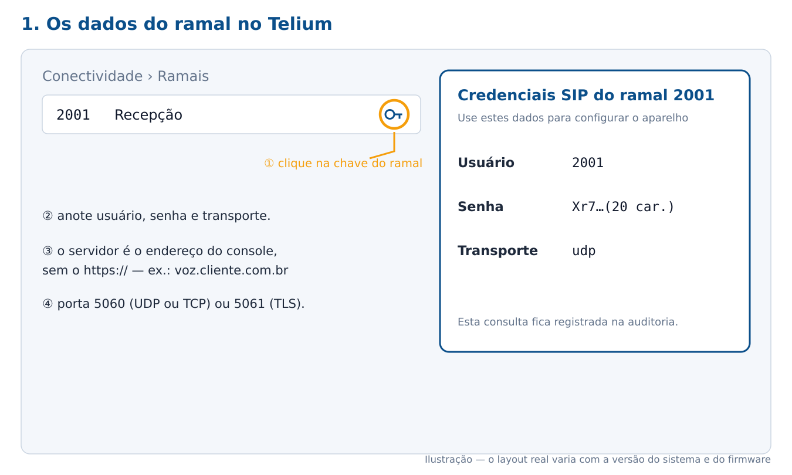
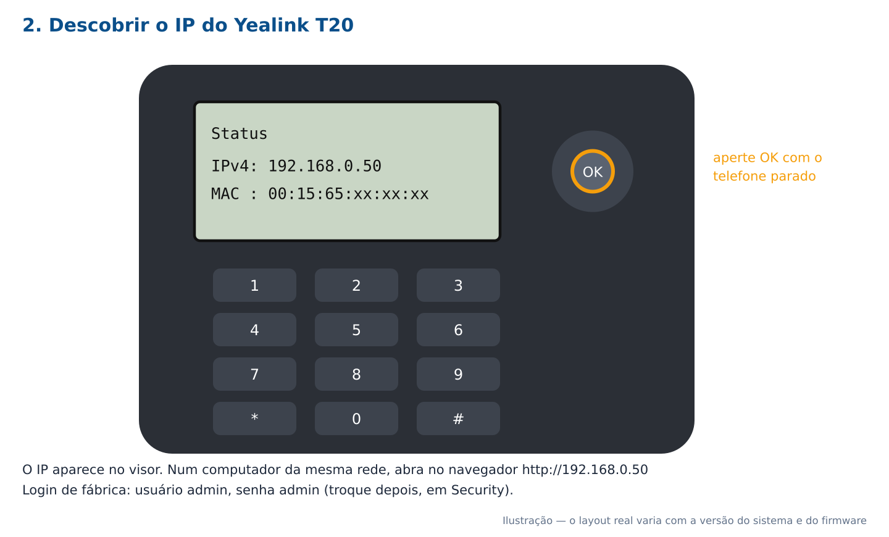
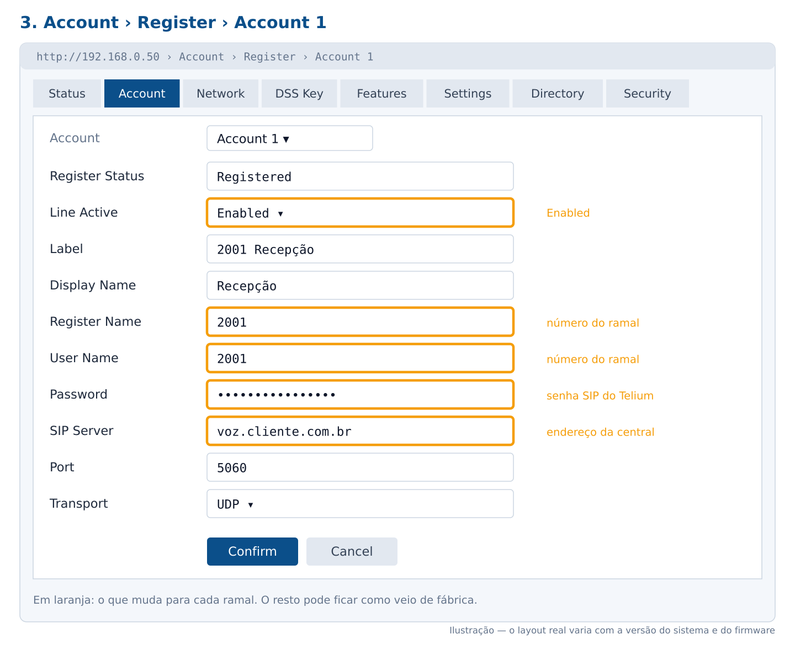
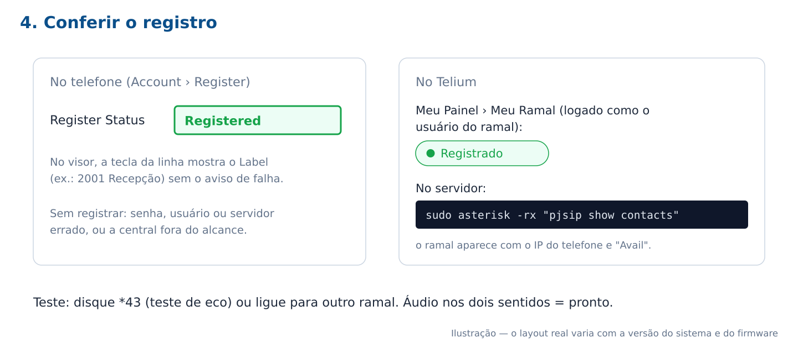

# Registrar um ramal no Yealink T20 / T20P — Telium PABX

Passo a passo para colocar um ramal do Telium num telefone **Yealink SIP-T20** ou **SIP-T20P** (o T20P é o mesmo aparelho com alimentação pela rede, PoE). Vale também para os outros modelos da linha T2x (T21, T22, T26, T28), que têm telas muito parecidas.

> As figuras desta página são **ilustrações**: mostram onde ficam os campos e o que preencher. O desenho real das telas muda um pouco com a versão do firmware do telefone. Os pontos marcados com [PRINT: ...] indicam onde colocar um print do aparelho de vocês.

---

## Sumário

1. [Antes de começar](#1-antes-de-começar)
2. [Os dados do ramal no Telium](#2-os-dados-do-ramal-no-telium)
3. [Descobrir o IP do telefone](#3-descobrir-o-ip-do-telefone)
4. [Configurar pelo navegador](#4-configurar-pelo-navegador)
5. [Configurar pelo teclado do telefone](#5-configurar-pelo-teclado-do-telefone)
6. [Conferir o registro](#6-conferir-o-registro)
7. [Ajustes que evitam problema](#7-ajustes-que-evitam-problema)
8. [Problemas comuns](#8-problemas-comuns)
9. [Muitos telefones: provisionamento automático](#9-muitos-telefones-provisionamento-automático)

---

## 1. Antes de começar

- O **ramal já cadastrado** no Telium, em **Conectividade › Ramais**, ativo.
- O telefone **ligado na rede** e com IP (pelo DHCP da rede, normalmente).
- Um computador **na mesma rede** do telefone, para abrir a página dele no navegador.
- A rede do telefone precisa alcançar a central na porta **5060** (UDP ou TCP) e na faixa de voz **10000 a 20000/UDP**. Veja [Rede e portas](03-Requisitos-Rede-e-Portas.md).

---

## 2. Os dados do ramal no Telium

**Conectividade › Ramais** → na linha do ramal, o botão da **chave** (Credenciais SIP).



| No Telium | O que é | Vai no telefone em |
|---|---|---|
| Usuário | O número do ramal (ex.: `2001`) | **Register Name** e **User Name** |
| Senha | A senha SIP do ramal | **Password** |
| Transporte | `udp`, `tcp` ou `tls` | **Transport** |
| — | O **endereço da central**: o mesmo do console, sem o `https://` (ex.: `voz.cliente.com.br`) | **SIP Server** |
| — | A porta: **5060** para UDP ou TCP, **5061** para TLS | **Port** |

- O botão da chave só aparece para quem pode **editar** ramais, e cada consulta fica registrada na auditoria.
- Para vários aparelhos de uma vez, **Exportar com senhas** (na mesma tela) baixa a planilha com a senha de todos os ramais. Não mande esse arquivo por e-mail e apague depois de usar.

> [PRINT: janela "Credenciais SIP do ramal" no Telium]

---

## 3. Descobrir o IP do telefone

Com o telefone **parado** (sem ligação), aperte a tecla **OK**. O visor mostra o **IPv4** e o **MAC** do aparelho.



Num computador da mesma rede, abra no navegador `http://<IP do telefone>` (ex.: `http://192.168.0.50`).

- Login de fábrica: usuário **admin**, senha **admin**.
- Se não abrir, confira se o computador está na mesma rede do telefone e se o IP foi digitado com `http://` (não `https://`).

> [PRINT: visor do T20 mostrando o IP depois da tecla OK]

---

## 4. Configurar pelo navegador

No navegador, aba **Account** › **Register** › escolha **Account 1** (o T20 tem duas contas: Account 1 e Account 2).



| Campo no telefone | O que pôr | Exemplo |
|---|---|---|
| Line Active | **Enabled** | Enabled |
| Label | O que aparece no visor, ao lado da tecla da linha | `2001 Recepção` |
| Display Name | O nome que o outro ramal vê ao receber a ligação | `Recepção` |
| Register Name | O **número do ramal** (o "Usuário" do Telium) | `2001` |
| User Name | O **número do ramal**, de novo | `2001` |
| Password | A **senha SIP** do Telium | (a do ramal) |
| SIP Server | O **endereço da central** | `voz.cliente.com.br` |
| Port | `5060` (ou `5061` com TLS) | `5060` |
| Transport | O **Transporte** do Telium | UDP |

Clique em **Confirm**. Em alguns segundos, o campo **Register Status**, no alto da mesma página, passa a mostrar **Registered**.

- **Register Name e User Name são o mesmo número.** No Telium o usuário de autenticação é o próprio número do ramal.
- Os demais campos (Outbound Proxy, NAT, STUN) **ficam como vieram de fábrica**: a central já cuida do NAT do lado dela.
- A **segunda conta** (Account 2) serve para um segundo ramal no mesmo aparelho, com os dados dele.

> [PRINT: página Account › Register do T20 preenchida, com Register Status "Registered"]

---

## 5. Configurar pelo teclado do telefone

Sem computador à mão, dá para fazer pelo próprio telefone:

1. Com o telefone parado, aperte **Menu**.
2. **Settings** › **Advanced Settings**. A senha de fábrica é **admin**.
3. **Accounts** › **Account 1**.
4. Preencha os mesmos campos da tabela da [seção 4](#4-configurar-pelo-navegador): ative a conta, número do ramal em Register Name e User Name, senha, servidor e porta.
5. Salve (tecla **Save** ou **OK**, conforme o firmware).

Pelo teclado, digitar o endereço e a senha é mais trabalhoso: para letras, aperte a tecla do número várias vezes, e use a tecla de **modo de entrada** (abc/123) para alternar.

> [PRINT: tela Accounts no visor do T20]

---

## 6. Conferir o registro



- **No telefone:** **Register Status = Registered** (navegador, Account › Register). No visor, a linha aparece com o Label, sem aviso de falha.
- **No Telium:** o usuário dono do ramal vê **Registrado** em **Meu Painel › Meu Ramal**, com o aparelho listado. No servidor:

```bash
sudo asterisk -rx "pjsip show contacts"
```

  O ramal aparece com o IP do telefone e o estado **Avail**.

- **Teste:** disque **\*43** (teste de eco: você ouve a própria voz) ou ligue para outro ramal. Áudio nos dois sentidos: pronto.

---

## 7. Ajustes que evitam problema

| Onde no telefone | O quê | Por quê |
|---|---|---|
| Account › Codec (conforme o firmware) | Deixe **G711A (PCMA)** e **G711U (PCMU)** ativos e em primeiro; **desative o G729** | O Telium não converte G729: com ele, chamadas caem quando o outro lado fala outro codec |
| Account › Advanced › DTMF Type | **RFC2833** (o padrão de fábrica) | É o que o Telium espera para as teclas na URA e nos códigos (\*11, \*43) |
| Security › Password | Troque a senha **admin** do telefone | Com a de fábrica, qualquer um na rede abre a página e vê a senha do ramal |
| Settings › Time & Date | Fuso **-3 (Brasília)** e servidor NTP | Hora certa no visor e no histórico do telefone |
| Settings › Upgrade | Firmware atualizado, quando possível | Firmwares antigos do T20 têm falhas conhecidas de registro e de áudio |

---

## 8. Problemas comuns

**Register Status fica em "Register Failed".**
Usuário, senha ou servidor errado. Confira:
- Register Name e User Name são **o número do ramal**;
- a senha é a da tela de credenciais do Telium. Copie e cole: a senha tem 12 caracteres ou mais e mistura maiúsculas e minúsculas;
- o SIP Server é o endereço da central, **sem** `https://` e sem barra no fim;
- o ramal está **ativo** no Telium.

**Funcionava e parou de registrar de uma hora para outra / o telefone não alcança a central.**
Depois de **5 senhas erradas em 10 minutos**, o firewall da central **bloqueia o IP do telefone por 24 horas**, e em rede com NAT bloqueia todos os aparelhos daquele endereço. Corrija a senha no telefone primeiro, depois libere o IP em **Conectividade › Firewall** → **Bloqueados agora pelo firewall** → desbloquear. Para a rede de um escritório fixo, inclua o IP em **Nunca bloquear**. Veja [Conectividade › Firewall](17-Conectividade.md).

**Registra, mas a ligação fica muda (ou só um lado ouve).**
A voz não passa pela rede: a faixa **10000 a 20000/UDP** precisa estar liberada entre o telefone e a central. Em escritório com roteador, desligue o **SIP ALG** do roteador, que costuma estragar as chamadas. Veja [Rede e portas](03-Requisitos-Rede-e-Portas.md).

**As teclas não funcionam na URA nem nos códigos.**
DTMF Type diferente de **RFC2833** (seção 7).

**A ligação cai ao atender.**
Codec: veja se o **G729** está desativado e o **G711** ativo (seção 7).

**Não abre a página do telefone.**
O computador precisa estar na mesma rede do telefone. Confira o IP pela tecla **OK**. Sem acesso pela rede, use o teclado ([seção 5](#5-configurar-pelo-teclado-do-telefone)). Para voltar o telefone ao padrão de fábrica, siga o manual do modelo (a senha admin volta a ser **admin**).

---

## 9. Muitos telefones: provisionamento automático

Para dezenas de aparelhos, em vez de configurar um por um, use o **Provisionamento** do Telium (**Conectividade › Provisionamento**). Cadastre o MAC de cada telefone com o ramal dele. O telefone busca a configuração pronta na central (para Yealink, o arquivo `<mac>.cfg`), com usuário, senha e servidor, e registra sozinho. Veja [Conectividade › Provisionamento](17-Conectividade.md).

---

## Veja também

- [Conectividade](17-Conectividade.md): ramais, credenciais, firewall e provisionamento.
- [Rede e portas](03-Requisitos-Rede-e-Portas.md): o que a rede precisa liberar.
- [Códigos de recurso](15-Codigos-de-Recurso.md): \*43 (eco) e os demais códigos.
- [Meu Painel (PCU)](21-Meu-Painel-PCU.md): o usuário vê o próprio ramal registrado.
